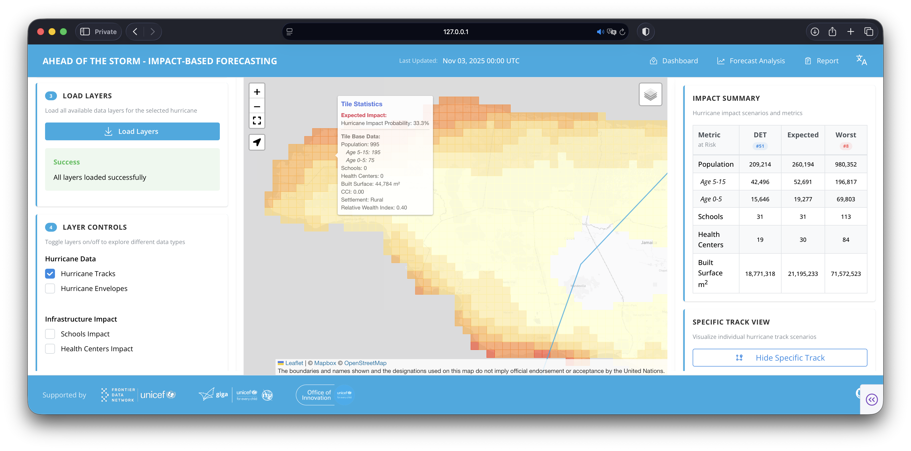

# Ahead of the Storm: Application Setup Guide

This repository contains the **Dash web application** for visualizing hurricane impact forecasts. The application displays interactive maps, probabilistic analysis, and impact reports based on pre-processed hurricane data.

## Related Repositories

- **[Ahead-of-the-Storm-DATAPIPELINE](https://github.com/unicef-drp/Ahead-of-the-Storm-DATAPIPELINE)**: Data processing pipeline for initializing base data and processing storm impact files that are read by the application
- **[TC-ECMWF-Forecast-Pipeline](https://github.com/unicef-drp/TC-ECMWF-Forecast-Pipeline)**: Pipeline for processing ECMWF tropical cyclone, wind gust and precipitation forecast data and GloFAS river forecasts
- **Ahead-of-the-Storm-ORCHESTRATION**: Snowflake-side setup that the application reads from: the materialized `*_MAT` impact tables, their refresh tasks, and the `SEND_ALERT` / `SEND_WARNING` email procedures
- **Ahead-of-the-Storm-DataAPI**: read-only REST API for querying the hazard and exposure dataset by semantic parameters (country, storm, hazard, date, ...)

## Prerequisites

1. **Python 3.11+** installed
2. **Virtual environment** activated (`.venv`)
3. **Environment variables** configured in `.env` file
   - Start from the provided example: `cp sample_env .env`
   - Edit values to match your environment (Snowflake, optional Azure)
4. **Pre-processed data** available (see [Data Requirements](#data-requirements) below)

### Environment Setup

```bash
python3 -m venv .venv
source .venv/bin/activate  # On Windows: .venv\Scripts\activate
pip install --upgrade pip
pip install -r requirements.txt -r services/requirements.txt
```

### Required Environment Variables

#### Snowflake Configuration
- `SNOWFLAKE_ACCOUNT`, `SNOWFLAKE_USER`, `SNOWFLAKE_PASSWORD`
- `SNOWFLAKE_WAREHOUSE`, `SNOWFLAKE_DATABASE`, `SNOWFLAKE_SCHEMA`
- `SNOWFLAKE_USE_RO` (optional, default `false`): when `true`, connects using `SNOWFLAKE_RO_USER`/
  `SNOWFLAKE_RO_PASSWORD` instead of `SNOWFLAKE_USER`/`SNOWFLAKE_PASSWORD` (a separate, more restricted
  read-only role)

#### Data Storage Configuration
- `ROOT_DATA_DIR` (default: `geodb`)
- `VIEWS_DIR` (default: `aos_views`)

#### Optional: Impact Data Storage

**`IMPACT_DATA_STORE`** selects how the tile server loads impact data:
- `SNOWFLAKE`: queries the Snowflake materialized tables (`*_MAT`) directly, with no file downloads. This is
  what the production SPCS deployment uses, not a mounted volume: the `Dockerfile`'s `VOLUME ["/DataStore"]`
  declaration is unused by the live service.
- `LOCAL` (default for the Dash app): reads the `*_views/` files from the local filesystem
- `BLOB`: reads the `*_views/` files from Azure Blob Storage (read-only)

Raw global river and precip files are read from the Snowflake stage or Blob.

With `IMPACT_DATA_STORE=SNOWFLAKE` the tile server queries:
- `MERCATOR_TILE_IMPACT_MAT`: tile-level probabilistic impact
- `ADMIN_ALL_IMPACT_MAT`: admin-region impact with probability
- `MERCATOR_TILE_CCI_MAT` / `ADMIN_ALL_CCI_MAT`: Child Climate Index overlays
- `SCHOOL_IMPACT_MAT` / `HC_IMPACT_MAT`: point data for schools and health centres
- `TRACK_MAT`: per-ensemble-member severity and envelope geometry

These tables must be set up first by the pipeline repositories listed under
[Related Repositories](#related-repositories).

Note: Snowflake is used for BOTH raw hurricane forecast data (TC_TRACKS / TC_ENVELOPES_COMBINED tables) AND impact data, so the Snowflake connection is always required.

- If using Azure Blob Storage: `ADLS_ACCOUNT_URL`, `ADLS_SAS_TOKEN`, `ADLS_CONTAINER_NAME`
- If using Snowflake stage: `SNOWFLAKE_STAGE_NAME` (name of the Snowflake internal stage)

#### SPCS Authentication (Snowflake Container Services deployment only)
- `SPCS_RUN`: set to `true` to enable OAuth token auth via `/snowflake/session/token` (default: `false`)
- `SPCS_TOKEN_PATH` (default: `/snowflake/session/token`)
- `SNOWFLAKE_HOST`, `SNOWFLAKE_PORT`: required when `SPCS_RUN=true`

#### Tile server
- `TILE_SERVER_URL` (optional): the tile server base URL used by browser clientside callbacks. Two different defaults apply depending on deployment mode: in local development (both `SPCS_RUN` and `BEHIND_REVERSE_PROXY` unset/false) the app falls back to `http://localhost:8001`; when running behind nginx (SPCS or Azure, `BEHIND_REVERSE_PROXY=true`) it's sent to the browser as an empty string so the browser resolves tile/geojson requests against `window.location.origin` instead. Set explicitly only if the tile server is on a different host than the one serving the Dash app.
- `BEHIND_REVERSE_PROXY` (optional, default `false`): set `true` whenever nginx fronts both Dash and the tile server on the same host (SPCS and Azure both use this), which changes the `TILE_SERVER_URL` behavior above.
- `RIVER_EXTENT_SOURCE` (optional, default `auto`): which GloFAS flood-extent layout the tile server reads for the global river layer. `auto` reads the compact `bymask` file when it exists in Blob and otherwise the by-member file, `bymask` requires the compact file, `bymember` never reads it (see `services/README.md`).

#### Mapbox (for map visualization)
- `MAPBOX_ACCESS_TOKEN` (optional, falls back to OpenStreetMap tiles)

## Data Requirements

**When `IMPACT_DATA_STORE=SNOWFLAKE`** (recommended): no local data files are needed. The tile server queries Snowflake MAT tables directly.

**When `IMPACT_DATA_STORE=LOCAL` or `BLOB`**: pre-processed impact views must be available in the configured store. For `LOCAL`, the following directories are expected:

- `{ROOT_DATA_DIR}/{VIEWS_DIR}/mercator_views/`: base Mercator tiles (demographic/infrastructure)
- `{ROOT_DATA_DIR}/{VIEWS_DIR}/admin_views/`: admin-region base and impact data
- `{ROOT_DATA_DIR}/{VIEWS_DIR}/school_views/`: school impact data
- `{ROOT_DATA_DIR}/{VIEWS_DIR}/hc_views/`: health centre impact data
- `{ROOT_DATA_DIR}/{VIEWS_DIR}/shelter_views/`: shelter impact data
- `{ROOT_DATA_DIR}/{VIEWS_DIR}/wash_views/`: WASH facility impact data

### Setting Up Data Processing

To generate the required data, follow the setup guide in the **[Ahead-of-the-Storm-DATAPIPELINE](https://github.com/unicef-drp/Ahead-of-the-Storm-DATAPIPELINE)** repository:

1. **Initialize base data** (demographic and infrastructure data, one-time setup)
2. **Process storm data** (run regularly to update with new storm data from Snowflake)

The hurricane forecast data is processed by the **[TC-ECMWF-Forecast-Pipeline](https://github.com/unicef-drp/TC-ECMWF-Forecast-Pipeline)** and loaded into Snowflake.

## Running the Application

### Development Mode

The Dash app and tile server must both be running. Start them in two separate terminals:

```bash
# Terminal 1: Dash app (http://127.0.0.1:8050)
python app.py

# Terminal 2: FastAPI tile server (http://127.0.0.1:8001)
# IMPACT_DATA_STORE=SNOWFLAKE is required here even if your .env sets LOCAL for the
# Dash app: the tile server's own impact-tile endpoints need it explicitly.
IMPACT_DATA_STORE=SNOWFLAKE uvicorn services.tile_server:app --host 0.0.0.0 --port 8001 --reload
```

### Production Deployment (SPCS)

Production runs as a Docker container on **Snowflake Container Services (SPCS)**. `entrypoint.sh` orchestrates three processes inside the container:

```
nginx  0.0.0.0:8000   (public, reverse proxy + tile cache)
  ├─► gunicorn Dash   127.0.0.1:8050  (1 worker × 8 threads)
  └─► uvicorn tiles   127.0.0.1:8001  (FastAPI tile server)
```

```bash
# Build
docker build -t unicef-dash-app:latest . --platform=linux/amd64
```

A single gunicorn worker (1 process × 8 threads) is required to avoid fork-safety issues with `snowflake-connector-python` and Dash callback-map race conditions. Do not increase `--workers` beyond 1.

## Application Features

1. **Map shell** (`/`): Full-bleed Global/Country-Analysis map, the app's only interactive page (the
   app has three routes: `/`, the printable `/breakdown-print` report, and the `/not-found-404` fallback). Independently
   toggleable hazard layers (Sustained Wind, Gust, River Flooding, Rainfall, Storm Surge preview) with
   per-hazard threshold sliders; a tile-click Hazard Contribution popup; a Full Impact Breakdown modal
   with a printable report page; schools/health centers/shelters/WASH facilities at risk; population
   impact tiles; i18n (es/fr/bn); an Alert Email viewer (per-country, opened from the Active Storms
   list) and a Warning Email viewer (per-storm).



2. **AI Agent**: the `HURRICANE_INTELLIGENCE` Snowflake Cortex agent is set up separately in Snowflake and
   reads the same MAT tables the map shell reads (see `snowflake/intelligence/`). The Dash app does not
   call it.

## Troubleshooting

### "No data available" or missing views
- If using `IMPACT_DATA_STORE=SNOWFLAKE`: verify Snowflake MAT tables are populated by the pipeline
  repositories listed under [Related Repositories](#related-repositories)
- If using `IMPACT_DATA_STORE=LOCAL` or `BLOB`: verify that impact views exist in `{ROOT_DATA_DIR}/{VIEWS_DIR}/`
- Run the storm processing pipeline from the [DATAPIPELINE repository](https://github.com/unicef-drp/Ahead-of-the-Storm-DATAPIPELINE)
- Check that Snowflake contains the expected storm data

### "Snowflake connection error"
- Verify all `SNOWFLAKE_*` environment variables are set correctly
- Check network connectivity to Snowflake
- Ensure Snowflake credentials have proper permissions

### "Map not loading" or missing map tiles
- Verify the tile server is running: `curl http://localhost:8001/health` should return `{"status":"ok"}`
- Verify `TILE_SERVER_URL` env var points to the tile server (default: `http://localhost:8001`)
- Verify `MAPBOX_ACCESS_TOKEN` is set (optional but recommended)
- Check browser console for JavaScript errors

### Application fails to start
- Verify all dependencies are installed: `pip install -r requirements.txt -r services/requirements.txt`
- Check that Python version is 3.11 or higher
- Review error logs for specific package or import errors

## Data Storage Locations

- **Base views:** `{ROOT_DATA_DIR}/{VIEWS_DIR}/mercator_views/` (e.g., `geodb/aos_views/mercator_views/`)
- **Impact views:**
  - `{ROOT_DATA_DIR}/{VIEWS_DIR}/admin_views/` (admin regions)
  - `{ROOT_DATA_DIR}/{VIEWS_DIR}/school_views/` (schools)
  - `{ROOT_DATA_DIR}/{VIEWS_DIR}/hc_views/` (health centers)
  - `{ROOT_DATA_DIR}/{VIEWS_DIR}/shelter_views/` (shelters)
  - `{ROOT_DATA_DIR}/{VIEWS_DIR}/wash_views/` (WASH facilities)

## Architecture

- **Frontend**: Dash with Mantine Components, MapLibre GL JS for tile rendering (Dash Leaflet as map container), Plotly for charts
- **Backend**: Python with GeoPandas for geospatial processing; FastAPI tile server sidecar (`services/tile_server.py`, port 8001) serves WebP raster tiles and MVT vector tiles
- **Data Sources**:
  - Snowflake: hurricane track/envelope data (`TC_TRACKS`, `TC_ENVELOPES_COMBINED`) and, when `IMPACT_DATA_STORE=SNOWFLAKE`, impact data via materialized tables (`*_MAT`)
  - Pre-processed impact views via [giga-spatial](https://github.com/unicef/giga-spatial), used when `IMPACT_DATA_STORE` is `LOCAL` or `BLOB`, and for the raw global river and precip files (Azure Blob or Snowflake stage)
- **Deployment**: Docker container on Snowflake Container Services (SPCS): nginx reverse proxy + gunicorn Dash app + uvicorn tile server (see `entrypoint.sh` and `Dockerfile`)
